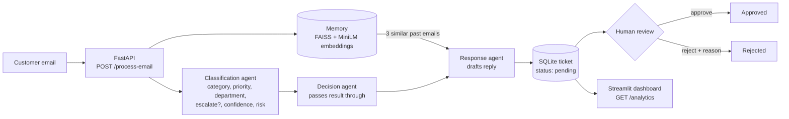

# OpsPilot AI

A prototype AI triage assistant for enterprise support. It reads a customer email, classifies and risk-scores it, drafts a reply using similar past issues, and holds the draft for a human to approve or reject.

> **Status:** prototype for exploring how AI decisions can be made visible and controllable. It is not production software and has not been formally evaluated.

<!-- TODO: add a 30-60 second demo GIF here, e.g.  -->

## The problem

Support teams receive a mix of routine questions and urgent incidents in the same inbox. Triage is slow and inconsistent, and automating replies without oversight is risky. This prototype tests a middle path: let the model do the sorting and drafting, but make its confidence and risk assessment visible and require human approval before anything goes out.

## What it does

1. Takes a customer email.
2. Classifies it (category, priority, department) and scores business risk and confidence.
3. Flags it for escalation when the model judges that it should be escalated.
4. Looks up similar past emails and uses them as context.
5. Drafts a professional reply.
6. Saves a ticket and waits for a human to approve or reject the draft, with a reason on rejection.
7. Shows ticket counts, priority and escalation numbers, and the ticket lifecycle in a dashboard.

## How it works



| Component | File | Role |
|---|---|---|
| API and routes | `backend/main.py`, `backend/routers/` | Process email, approve, reject, ticket timeline, analytics |
| Agents | `backend/ai/agents.py` | Three functions: classify, decide, respond |
| LLM calls | `backend/ai/openai_service.py` | Prompted classification with a risk rubric, and reply drafting |
| Memory | `backend/ai/vector_service.py` | In-memory FAISS index over sentence-transformer embeddings |
| Storage | `backend/models/ticket.py` | Ticket with approval fields and lifecycle timestamps |
| UI | `frontend/app.py` | Streamlit dashboard and review screens |

## Design decisions

- **Human approval is part of the data model.** Each ticket carries approval status, approver, timestamp and rejection reason, so oversight is recorded, not just implied.
- **Risk means business impact.** The classification prompt defines a rubric (for example, a production outage scores above 0.9 and a feature request around 0.2) so scores are comparable across tickets.
- **Separate agent functions.** Classification, decision and response are separate functions so each can later be replaced, tested or given its own model without touching the others.
- **Memory is a separate layer.** Retrieval sits behind two functions (`add_document`, `search_similar`), so the FAISS index can be swapped for a persistent store.

## Known limitations

- **The decision agent is a pass-through.** It currently returns the classifier's output unchanged, so only two LLM calls run per email (classify, respond). The three-stage structure is in place; independent decision logic is not.
- **Confidence and risk are self-reported by the model.** They have not been calibrated against real outcomes, and classification runs at temperature 0.7, so the same email can be scored differently on different runs.
- **Failures look low-risk.** If the model call fails, the code falls back to category "Other", priority "Medium" and risk 0.3. A real deployment should surface the failure instead.
- **Memory is in-process.** The FAISS index is lost on restart, and it stores raw email text with no redaction of personal data.
- **Retrieval returns past emails, not past resolutions**, so the drafting step sees what customers asked, not how it was solved.
- **Approval does not send anything.** The approver is hard-coded and there is no authentication or role model.
- **No automated tests or evaluation set yet.** `test.py` only checks API connectivity.

## What I would do next with real users

1. Hand-label 50-100 synthetic and anonymized emails, then measure classification accuracy and escalation precision and recall.
2. Log how often a reviewer approves a draft as-is, edits it, or rejects it, and use that as the main quality signal.
3. Lower the temperature and add schema-validated output, plus an explicit failure state.
4. Persist memory, store resolutions with emails, and redact personal data before storing.
5. Add authentication and real approver identity.

## Run it locally

Requires Python 3 and an OpenAI API key.

```bash
# 1. Configure
echo "OPENAI_API_KEY=your-key" > .env      # never commit this file

# 2. Backend (run from the backend folder)
cd backend
pip install -r requirements.txt
uvicorn main:app --reload                  # http://127.0.0.1:8000

# 3. Frontend (new terminal)
cd frontend
pip install -r requirements.txt
streamlit run app.py
```

The first run downloads the `all-MiniLM-L6-v2` embedding model.

## Tech stack

Python, FastAPI, Streamlit, OpenAI API, sentence-transformers, FAISS, SQLite, SQLAlchemy.
